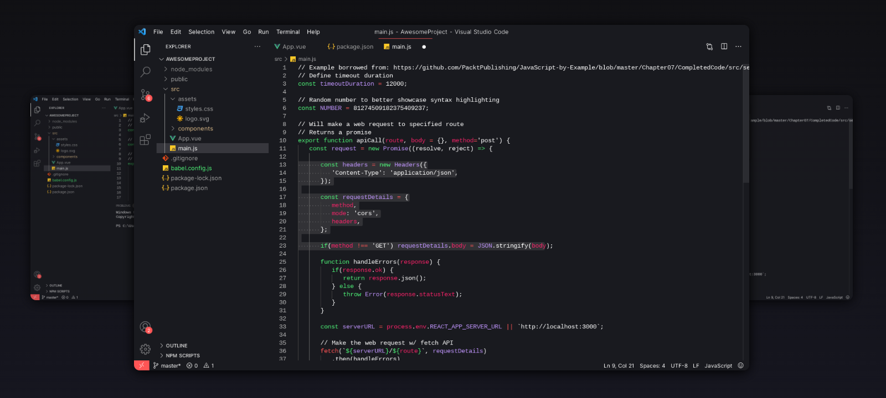
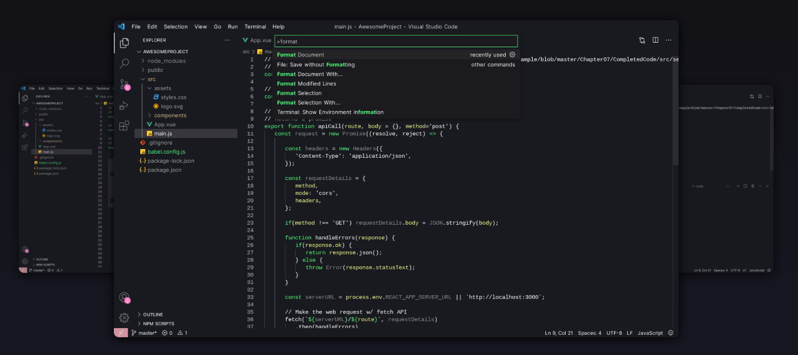

# Werewolf Official

A dark theme for [VS Code](https://code.visualstudio.com/), based on Dracula.

## Installation

1. Open the Extensions view in VS Code (`Ctrl+Shift+X`).
2. Search for **Werewolf Official** and click **Install**.
3. Open the Command Palette (`Ctrl+Shift+P`), run **Preferences: Color Theme** and pick **Werewolf Theme**.

Or install it straight from the [Marketplace](https://marketplace.visualstudio.com/items?itemName=Johnn7.werewolf-official).

## Credits

- [Dracula](https://draculatheme.com/visual-studio-code), the theme this one is based on.
- [Freepik](https://www.flaticon.com/br/autores/freepik) for the icon.

## License

[MIT](./LICENSE)
